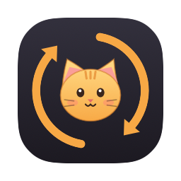
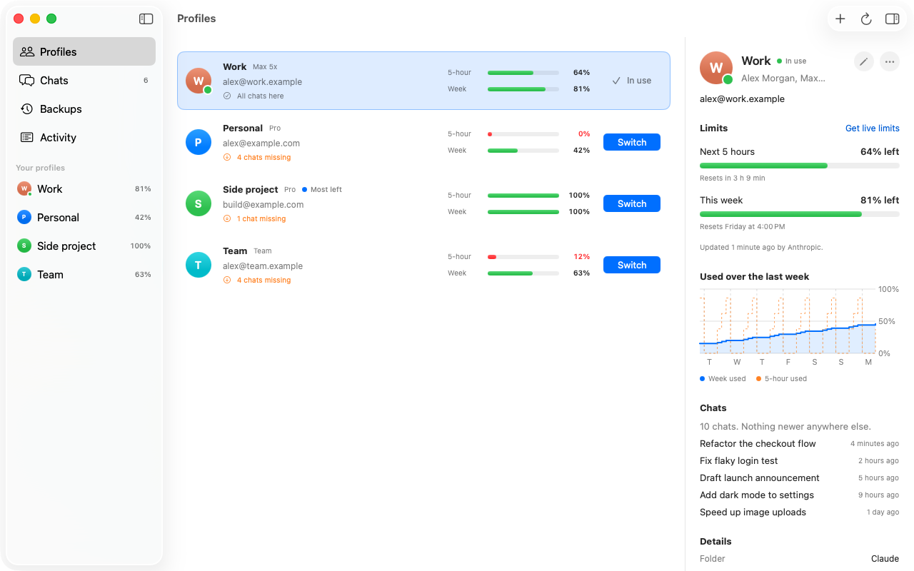
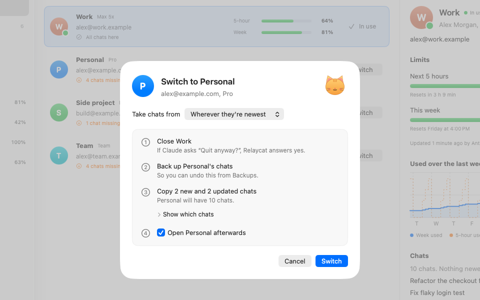
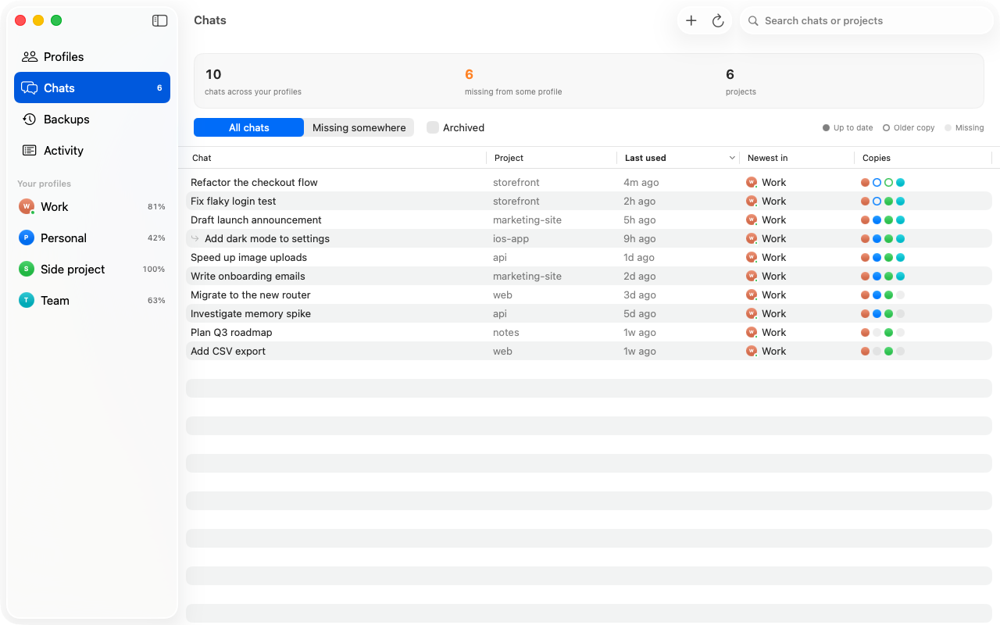
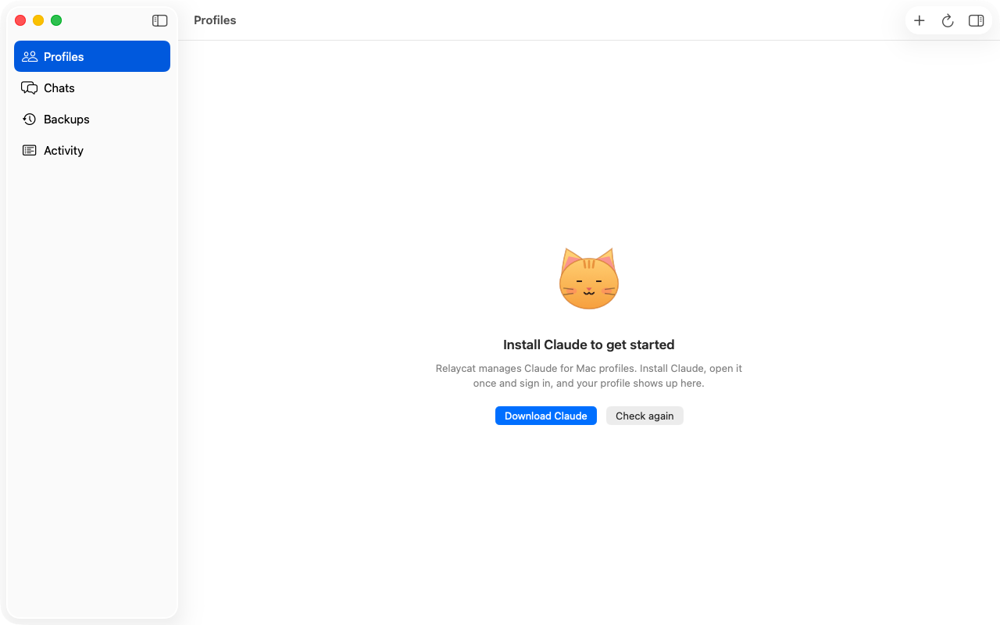

<div align="center">



# Relaycat: run multiple Claude accounts on one Mac

### Switch Claude Desktop between accounts in one click, see every account's usage limits, and keep your chats.

[](#install)
[](#install)
[](Sources)
[](#how-it-works)
[](LICENSE)
[](.github/workflows/build.yml)
[](https://github.com/krutikJain/relaycat/releases/latest)

[Install](#install) · [What it does](#what-it-does) · [Compared with other ways](#ways-to-use-two-claude-accounts-on-a-mac) · [FAQ](#faq) · [Contributing](#contributing)

<code>git clone https://github.com/krutikJain/relaycat && cd relaycat && ./build.sh --install</code>

</div>

**Relaycat** is a free, open-source Mac app for people who use more than one Claude account, such as a work account and a personal one, or two Pro accounts. It runs each account as its own Claude for Mac profile, switches between them in one click, shows each account's 5-hour session limit and weekly limit in the menu bar, and copies your newest chats across so a switch never loses work. It's a native Swift app for macOS 14 Sonoma or later, on Apple silicon and Intel.

> [!IMPORTANT]
> Relaycat is an independent, community project. It isn't made by or affiliated with Anthropic.
> It works with the Claude for Mac app you already have and doesn't change it.

<div align="center">
<br />
<picture>
  <source media="(prefers-color-scheme: dark)" srcset="docs/images/profiles-dark.png" />
  
</picture>
<br /><br />
</div>

---

You hit the 5-hour limit on one Claude account in the middle of something. You have another account, but switching means signing out, or quitting Claude and opening another copy, and then finding your chats aren't there.

Relaycat does that in one click. It closes the Claude that's open, copies the newest version of every chat into the account you're switching to, and opens it. A backup is saved first, every time.

## What it does

| Feature | What it means |
| --- | --- |
| **Switch in one click** | Closes the open Claude (and answers its "Quit anyway?"), brings the newest chats across, opens the other profile. |
| **Limits at a glance** | Session and weekly limits for every account, with reset times. The menu bar shows the one you're using. |
| **Chats come with you** | Each switch copies the newest copy of every chat, plus its notes and working folder, so nothing breaks later. |
| **Profiles made easy** | Create, rename, recolor and delete profiles. Each gets its own app in Applications with a matching icon. |
| **Safe by default** | A backup before every switch, one-click restore, and anything deleted goes to the Trash. |

<table>
<tr>
<td width="50%" valign="top">
<picture>
  <source media="(prefers-color-scheme: dark)" srcset="docs/images/switch-dark.png" />
  
</picture>
<p align="center"><sub>Every switch shows exactly what will happen, then ticks each step off.</sub></p>
</td>
<td width="50%" valign="top">
<picture>
  <source media="(prefers-color-scheme: dark)" srcset="docs/images/chats-dark.png" />
  
</picture>
<p align="center"><sub>See which profile has the newest copy of every chat, and which are behind.</sub></p>
</td>
</tr>
</table>

### The menu bar

<picture>
  <source media="(prefers-color-scheme: dark)" srcset="docs/images/menubar-dark.png" />
  
</picture>

Bars and a percentage show the current session. When the session is used up the bars empty and refill as the reset gets closer, next to a countdown. When the week is used up too it turns red and shows the day it comes back. Click it for both limits and a list of profiles to switch to.

### Meet Mochi

<picture>
  <source media="(prefers-color-scheme: dark)" srcset="docs/images/mochi-dark.png" />
  
</picture>

Mochi keeps an eye on the account you're using. Ready while there's plenty left, sleepy when the session runs low, napping once it's used up, and thrilled when a switch finishes. Every now and then Mochi strolls across the bottom of the window. If you'd rather not have company, turn it off in Settings.

## Ways to use two Claude accounts on a Mac

| | Sign out and back in | Two copies of Claude.app | `CLAUDE_CONFIG_DIR` aliases | Relaycat |
| --- | --- | --- | --- | --- |
| Works with the Claude for Mac app | Yes | Yes | No, terminal Claude Code only | Yes |
| Accounts stay signed in | No | Yes | Yes | Yes |
| Chats follow you to the other account | No | No | No | Yes, newest copy of each chat |
| See every account's limits in one place | No | No | No | Yes, session and weekly, in the menu bar |
| Suggests the account with the most left | No | No | No | Yes |
| Backup before each switch | No | No | No | Yes |
| Setup | None | Copy and rename the app by hand | Shell aliases per account | One app, one click per profile |

## Install

**Build from source** (about a minute, needs the Xcode Command Line Tools):

```bash
xcode-select --install   # skip if you already have it
git clone https://github.com/krutikJain/relaycat.git
cd relaycat
./build.sh --install
```

That builds one app for both Apple silicon and Intel and puts it in Applications.

**Or download a release** from [Releases](https://github.com/krutikJain/relaycat/releases), unzip, and drag Relaycat to Applications. Release builds aren't notarized yet, so the first time macOS will refuse to open it. Right-click Relaycat and choose **Open**, or run:

```bash
xattr -dr com.apple.quarantine /Applications/Relaycat.app
```

**Requirements:** macOS 14 Sonoma or later, and [Claude for Mac](https://claude.ai/download).

## First run

1. Open Relaycat. Your Claude profile shows up with its email, plan and limits.
2. Press **New profile** to add a second account. It opens in its own window so you can sign in.
3. When one account runs low, press **Switch** on another.

Optional, both asked for only when you turn them on:

- **Live limits** read each account's limits straight from Anthropic. macOS asks once to let Relaycat use "Claude Safe Storage". Choose **Always Allow**.
- **Accessibility** lets Relaycat press "Quit anyway" when Claude asks before closing. Without it, Relaycat waits a few seconds and closes Claude itself.

<details>
<summary><strong>What you'll see before you have any profiles</strong></summary>
<br />
<picture>
  <source media="(prefers-color-scheme: dark)" srcset="docs/images/first-run-dark.png" />
  
</picture>
</details>

## How it works

Claude for Mac keeps each profile in its own folder under `~/Library/Application Support` (`Claude`, `Claude-2`, …) and can open any of them with `--user-data-dir`. Relaycat reads those folders directly:

| What you see | Where it comes from |
| --- | --- |
| Email and plan | The account record Claude caches in the profile's IndexedDB |
| Limits | Anthropic's usage endpoint (live limits on), or what Claude recorded while it was open |
| Chats | The chat records in `claude-code-sessions` |
| Profile apps | Small launchers in Applications that open Claude with the right folder |

When you switch, Relaycat closes Claude, saves a backup of the target profile's chat list, copies the newest version of each chat (rewriting paths that pointed into the old profile and copying the folders they point to), then opens the target. The whole app is plain Swift with no third-party code.

## Privacy and security

- Everything stays on your Mac. Relaycat has no server and no analytics.
- With live limits on, each profile's short-lived access token is sent only to `api.anthropic.com`. Refresh tokens are never used, so no Claude ever gets signed out.
- Nothing is deleted outright. Deletes go to the Trash, and every switch or restore saves a backup first.

## FAQ

<details open>
<summary><strong>How do I use two Claude accounts on one Mac?</strong></summary>
<br />
Install Relaycat, open it, and press <strong>New profile</strong>. A second Claude window opens where you sign in with the other account. From then on, press <strong>Switch</strong> on whichever account you want, or pick it from the menu bar. Each account also gets its own app in Applications, so you can open it from Spotlight or the Dock.
</details>

<details>
<summary><strong>Can I run two Claude accounts at the same time?</strong></summary>
<br />
Yes. Each profile is a separate Claude for Mac instance with its own sign-in, so you can open more than one from its app in Applications. Use <strong>Switch</strong> when you want to move your chats to the other account and close the one you're leaving.
</details>

<details>
<summary><strong>How do I see the usage limits of all my Claude accounts?</strong></summary>
<br />
Relaycat lists every account with its 5-hour session limit, its weekly limit and when each resets. Turn on live limits in Settings to read them straight from Anthropic. The menu bar shows the account you're using, and the account with the most left is marked so you know where to switch.
</details>

<details>
<summary><strong>Does Relaycat work with Claude Code?</strong></summary>
<br />
It works with the Code tab inside Claude for Mac: those chats are copied across when you switch, along with their notes and working folders. It doesn't change which account the <code>claude</code> command in your terminal uses. For that, use a separate <code>CLAUDE_CONFIG_DIR</code> per account.
</details>

<details>
<summary><strong>Is Relaycat free and safe?</strong></summary>
<br />
It's free and MIT licensed, and the full source is in this repository. It has no server and no analytics. With live limits on, each profile's short-lived access token is sent only to <code>api.anthropic.com</code>, and refresh tokens are never used. Deletes go to the Trash, and every switch saves a backup first.
</details>

<details>
<summary><strong>Does this break Claude's terms or modify Claude?</strong></summary>
<br />
Relaycat doesn't modify Claude.app. It opens Claude with its own supported <code>--user-data-dir</code> option and reads files Claude keeps on your Mac. Use accounts you're entitled to, the same as you would without it.
</details>

<details>
<summary><strong>Will switching lose anything that's running?</strong></summary>
<br />
Claude has to close to switch. If a chat was busy in the last few minutes, the switch sheet tells you before you confirm. Background commands in that Claude stop, the same as quitting it yourself.
</details>

<details>
<summary><strong>Why does macOS ask about "Claude Safe Storage"?</strong></summary>
<br />
That's the keychain item Claude uses to encrypt its saved logins. Relaycat needs it to read each profile's access token for live limits. It's only asked for if you turn live limits on. Choose Always Allow so it doesn't ask again.
</details>

<details>
<summary><strong>I used Claude Graft before. Can I move over?</strong></summary>
<br />
Yes. Relaycat notices Graft's profile apps and offers to rebuild them as its own, keeping names and colors. It imports names and colors once and doesn't need Graft after that.
</details>

<details>
<summary><strong>Something looks wrong. How do I undo a switch?</strong></summary>
<br />
Open Backups, find the profile and the time, and press Restore. The current state is backed up first, so a restore can be undone too.
</details>

## Contributing

Issues and pull requests are welcome. Start with [CONTRIBUTING.md](CONTRIBUTING.md). You can try everything without touching your real profiles:

```bash
./build.sh && open build/Relaycat.app --args --demo
```

## Credits

The approach to reading profile tokens and building profile launchers was informed by [Claude Graft](https://github.com/aaditya-v-more/claude-graft) (MIT). Relaycat is a separate implementation.

## License

[MIT](LICENSE)
